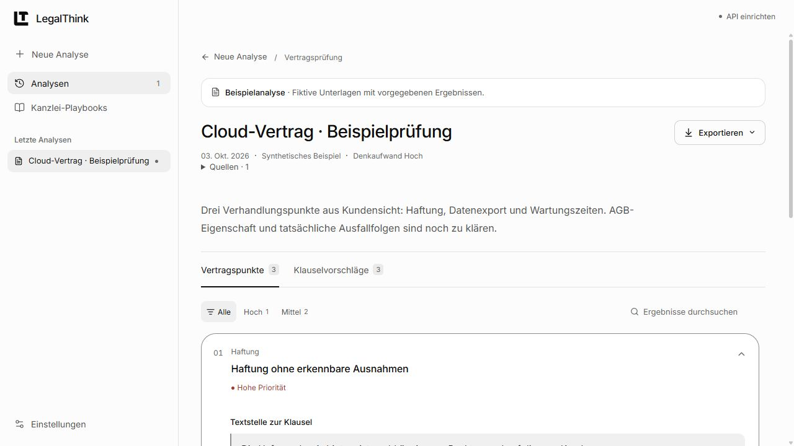
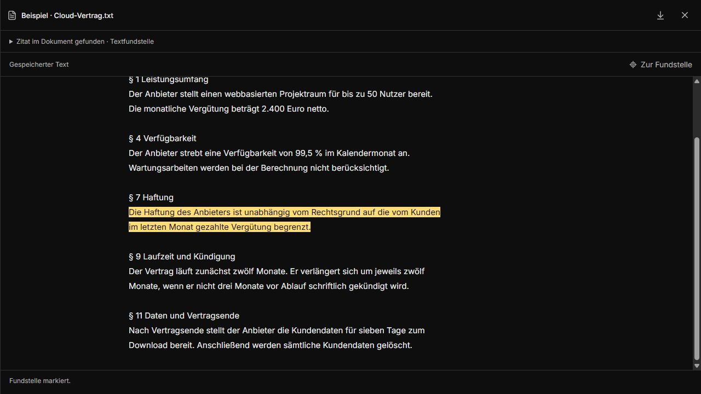

# LegalThink

Lokal betriebene Webanwendung für juristische Dokumentarbeit: Verträge prüfen, Fassungen vergleichen, Sachverhalte ordnen und Datenschutz- oder Werbefragen bearbeiten. Dokumente und eingefügte Texte bilden die Quellen der Analyse; Fundstellen lassen sich neben dem Ergebnis öffnen. Die KI-Analyse nutzt die OpenAI Responses API.

[Lokal starten](#lokal-starten) · [Aufgaben](#aufgaben) · [Konfiguration](#konfiguration) · [Daten und Grenzen](#daten-und-grenzen) · [Mitwirken](CONTRIBUTING.md)

<picture>
  <source media="(prefers-color-scheme: dark)" srcset="docs/images/analysis-dark.jpg">
  <source media="(prefers-color-scheme: light)" srcset="docs/images/analysis-light.jpg">
  
</picture>

Die Screenshots zeigen die Anwendung mit synthetischen Beispieldaten.

## Aufgaben

| Aufgabe | Eingabe und Ergebnis |
| --- | --- |
| **Vertrag** | Vertrag und optional Mandantenrolle oder Prüfschwerpunkt; Befunde mit Klauselbelegen und getrennten Formulierungsvorschlägen. |
| **Vergleich** | Eigener Entwurf und Gegenentwurf; Wortlaut beider Fassungen, Bewertung der Änderungen und Verhandlungsvorschläge. |
| **Chronologie** | Unterlagen, E-Mails und Notizen; Ereignisse mit Datierung, Belegen und offenen Sachverhaltsfragen. |
| **Datenschutz** | Allgemeine Prüfung, Auftragsverarbeitungsvertrag (AVV) oder Vorbereitung einer Datenschutz-Folgenabschätzung (DSFA); Prüfpunkte und fehlende Angaben passend zur Aufgabe. |
| **Werbung** | Aussagen, Medium, Zielgruppe und Nachweise; Prüfbedarf und rechtliche Anknüpfungspunkte. |

**Kanzlei-Playbooks** ergänzen eigene Prüfmaßstäbe und Formulierungsvorgaben. Jede Aufgabe hat ein Beispiel ohne API-Aufruf; Datenschutz bietet separate Beispiele für Allgemein, AVV und DSFA. Berichte lassen sich als Word oder Markdown exportieren. Bestätigte Originalzitate und Änderungsvorschläge erscheinen im Word-Prüfbericht als nachverfolgte Änderungen; die Quelldatei wird nicht umgeschrieben.

## Fundstellen prüfen

Ein Klick auf den Dokumentnamen oder **Fundstelle ansehen** öffnet die Quelle rechts neben der Analyse. Auf schmalen Bildschirmen nutzt die Vorschau das ganze Fenster.



- **PDF:** Originalseiten, Seitenwahl, Zoom und Markierung eines eindeutig zugeordneten Zitats. Die Dokumentfarben bleiben auch im Dark Mode erhalten.
- **DOCX:** formatierte Vorschau mit Tabellen und Bildern. Seitenumbrüche und Layout können von Microsoft Word abweichen.
- **TXT und Markdown:** vollständiger Quelltext mit Zitatmarkierung; Markdown zusätzlich als Leseansicht.
- **Eingefügter Text:** wird nach erfolgreicher Analyse als eigene TXT-Quelle gespeichert, etwa für kopierte E-Mail-Verläufe.

Originaldateien bleiben zum Download erhalten. Eine bestätigte Fundstelle belegt den Wortlaut im Dokument, nicht die rechtliche Bewertung oder die Wahrheit der darin beschriebenen Tatsachen.

## Lokal starten

Voraussetzungen: **Node.js 22.12+** und [uv](https://docs.astral.sh/uv/getting-started/installation/). Python 3.12 wird empfohlen und in CI verwendet; das Backend unterstützt Python ab 3.11.

```sh
git clone https://github.com/marlonka/legalthink.git
cd legalthink
npm ci
npm --prefix frontend ci
uv sync --project backend --extra dev --frozen
npm run dev
```

Unter [localhost:5175](http://localhost:5175) eine Aufgabe wählen und **Beispiel öffnen** anklicken. Dafür ist kein API-Schlüssel nötig. Der Startbefehl führt Vite auf Port 5175 und FastAPI auf Port 8000 aus; beide binden an `127.0.0.1`.

### Eigene Unterlagen analysieren

1. [backend/.env.example](backend/.env.example) als `backend/.env` kopieren, `OPENAI_API_KEY` eintragen und den Server neu starten. Der Schlüssel bleibt im Backend; `.env` ist von Git ausgeschlossen.
2. Aufgabe wählen. PDF, DOCX, TXT oder Markdown hinzufügen oder Text direkt einfügen. Ein Vergleich benötigt genau zwei Dateien: zuerst den eigenen Entwurf, dann den Gegenentwurf.
3. Bei Bedarf den **Prüfauftrag** ergänzen oder eine Vorlage übernehmen. Ein Playbook kann eigene Vorgaben hinzufügen.
4. Modell, Webrecherche und weitere Einstellungen prüfen. **Analyse starten** überträgt die ausgewählten Inhalte an OpenAI und kann API-Kosten auslösen.
5. Ergebnisse und Quellen prüfen; den Bericht bei Bedarf exportieren.

<details>
<summary>Gebaute Anwendung ohne Vite starten</summary>

Nach der Installation:

```sh
npm run build
uv run --project backend uvicorn app.main:app --app-dir backend --host 127.0.0.1 --port 8000
```

Öffnen: [localhost:8000](http://localhost:8000). FastAPI liefert Oberfläche und API auf derselben Adresse aus. Einen bereits laufenden Entwicklungsserver auf Port 8000 vorher beenden.

</details>

## Konfiguration

Die Serverkonfiguration liegt in `backend/.env`. Änderungen erfordern einen Neustart.

| Variable | Zweck |
| --- | --- |
| `OPENAI_API_KEY` | OpenAI-Projektschlüssel für gestartete Analysen. Niemals als `VITE_`-Variable hinterlegen. |
| `OPENAI_PROCESSING_REGION` | Vorgabe `global` oder `eu`; ohne Angabe `global`. EU setzt ein dafür geeignetes OpenAI-Projekt voraus. |
| `LEGALTHINK_DATA_DIR` | Speicherverzeichnis; standardmäßig `backend/data`. |

Weitere Betriebsoptionen stehen in der [Konfigurationsvorlage](backend/.env.example) und der [Architektur](docs/architecture.md#operational-scope).

**Modell:** Neue Installationen und Browserprofile starten mit `gpt-6-luna` und **Sehr hoch** (`xhigh`). `gpt-6.1-sol` steht zur Auswahl; eine eigene Auswahl bleibt im jeweiligen Browser gespeichert. Weitere Modell-IDs lassen sich in den Einstellungen ergänzen, sofern sie Responses API und Structured Outputs unterstützen. Das Hinzufügen prüft keinen Modellzugang und löst keinen API-Aufruf aus.

**Webrecherche:** standardmäßig aktiviert; über das Globussymbol neben der Modellauswahl abschaltbar. Nutzt OpenAIs gehostete Websuche; Suchanfragen können Dokumentinhalte enthalten.

**Region und Verarbeitung:** Global/EU sowie Standard/Flex sind in den erweiterten Einstellungen wählbar. Die Regionsauswahl bestimmt den Endpoint, bestätigt aber keine Projektfreigabe oder Datenresidenz. Bei Fehlern gibt es keinen automatischen Wechsel zu Global oder Standard und keine automatische Wiederholung. Details zu Modellen, Verarbeitung und Prompt-Caching: [OpenAI-Integration](docs/openai-integration.md).

## Daten und Grenzen

- **Lokaler Einzelbenutzerbetrieb:** Dokumenttexte, Originaldateien, Playbooks und Analysen liegen in SQLite, standardmäßig unter `backend/data/workspace.sqlite3`. Keine integrierte Benutzeranmeldung, Mandantentrennung oder Datenbankverschlüsselung. Die Anwendung nicht ungeschützt ins Internet stellen.
- **Übertragung:** Beim Analysestart gehen ausgewählte Dokumenttexte, eingefügter Text, Prüfauftrag und gegebenenfalls Playbook an OpenAI. `store=false` verhindert die Speicherung als abrufbares Response-Objekt; es garantiert weder Zero Data Retention noch EU-Verarbeitung.
- **Löschung:** Ein Dokument zu löschen entfernt seinen gespeicherten Text und seine Originaldatei. Bereits gespeicherte Berichte können weiterhin Zitate daraus enthalten und müssen bei Bedarf zusätzlich gelöscht werden.
- **Import:** PDFs benötigen eine Textebene; integrierte OCR gibt es nicht. Offene Textänderungen in DOCX müssen vor dem Import in einer Kopie angenommen oder abgelehnt werden. Die Analyse verarbeitet ausgelesenen Text und erfasst visuelle Inhalte nicht vollständig.
- **Ergebnisqualität:** Berichte sind Arbeitsentwürfe. Quellen, Rechtslage und Fristen müssen vor ihrer Verwendung geprüft werden. Die mitgelieferten Beispiele und simulierten Tests belegen keine Modellqualität.

| Eingabegrenze | Umfang |
| --- | --- |
| Einzeldatei | 12 MiB; bis zu 200.000 ausgelesene Zeichen; PDF zusätzlich höchstens 120 Seiten |
| Material einer Analyse | Bis zu 1.000.000 Zeichen aus ausgewählten Dokumenten und eingefügtem Text zusammen |
| Prüfauftrag | Separat bis zu 10.000 Zeichen |

Vor dem Übermitteln von Mandatsdaten müssen Übermittlungsberechtigung, anwaltliche Verschwiegenheit, Datenschutz und erforderliche Verträge geklärt sein. Zugriffsschutz, Datensicherung und die Verwendung der Ergebnisse liegen beim Betreiber. Ausführliche Einordnung: [rechtliche Bestandsaufnahme](docs/legal-review.md) und [API-Datenverarbeitung](docs/openai-integration.md#data-handling-claims).

## Entwicklung und Dokumentation

React und TypeScript bilden die Oberfläche; FastAPI und SQLite das Backend. API-Schlüssel werden nicht an den Browser ausgeliefert. Die automatisierten Tests nutzen synthetische Daten und simulierte Providerantworten.

| Dokument | Inhalt |
| --- | --- |
| [Architektur](docs/architecture.md) | Komponenten, Speicherung, Quellenmodell und Betriebsgrenzen |
| [OpenAI-Integration](docs/openai-integration.md) | API-Vertrag, Modelle, Prompt-Caching, Webrecherche und Regionen |
| [Gestaltung](design.md) | Themes, Komponenten, Barrierefreiheit und Bewegung |
| [Designsystem für andere Projekte](docs/reusable/design.md) | Eigenständige Regeln, Tokens und Interaktionsmuster für Weboberflächen |
| [Prüfprotokoll](docs/validation.md) | Ausgeführte Prüfungen und verbleibende Grenzen |
| [Performance](docs/performance.md) | Messbedingungen und Ergebnisse |
| [Modellbewertung](evals/README.md) | Synthetische Fälle und Bewertungskriterien |
| [Sicherheit](SECURITY.md) | Sicherheitsprobleme melden und Schutzgrenzen der Anwendung |

## Mitwirken und Lizenz

Fehlerberichte brauchen reproduzierbare Schritte und synthetische Beispieldaten. Keine Mandatsunterlagen, Zugangsdaten oder lokalen Datenbanken in Issues und Pull Requests veröffentlichen. Einrichtung, relevante Prüfungen und Beitragsregeln: [CONTRIBUTING.md](CONTRIBUTING.md).

Der Projektcode steht unter der [MIT-Lizenz](LICENSE), Copyright © 2026 Marlon Kaulich. Bibliotheken und Fonts behalten ihre eigenen Lizenzen; der Frontend-Build liefert die Hinweise unter `/third-party-licenses.txt` aus. Das Projekt ist unabhängig von OpenAI.

Die [Namensvorprüfung](docs/name-check.md) dokumentiert den bisherigen Rechercheumfang und offene Fragen; sie bestätigt keine Markenfreiheit.
