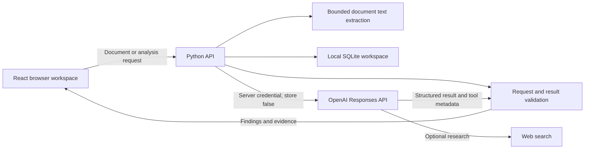

# LegalThinkGPT architecture

Decision record — **3 October 2026**.

## Product boundary

LegalThinkGPT is a German legal-work assistant with five focused workflows: contract review, version comparison, chronology, privacy/compliance review, and advertising review. The result is an editable review aid: findings, document evidence, suggested wording, and open questions. A human reviewer decides whether to accept a suggestion.

The application separates a clearly marked example from an actual model analysis. An example result cannot establish model accuracy. The Word export contains genuine OOXML insertions and deletions for confirmed quotations and their proposed replacements. Those revisions live in a review memo; the original contract's layout and content are not rewritten.

## Components and trust boundaries

The browser owns interaction state and review decisions. Python owns credentials, request limits, document extraction, model/effort validation, prompt assembly, and provider error handling. SQLite persists extracted documents, playbooks, and results in local plaintext at `backend/data/workspace.sqlite3` by default; original uploads are not retained. `LEGALTHINK_DATA_DIR` changes the storage directory. Provider output is untrusted until it passes structural validation; legal assertions still require review afterward. File contents and playbooks never become higher-priority instructions.

New browser profiles and API requests without explicit model settings default to `gpt-6-luna` / `high`. Model and effort preferences persist in that browser. Each of the five workflows and the AVV/DSFA subtasks keeps separate draft documents, context, playbook and research settings in the current browser session; drafts are not persisted across reload. `compliance_task` selects a backend instruction independently of the user's optional context. Results retain ordered `document_ids` and the chosen subtask; older records receive compatible defaults. `POST /api/demo` accepts an optional `scenario` and returns an `Analysis`; omission keeps the original contract example behavior.

`source_text` accepts pasted source material separately from `context` (the analysis instructions). Non-comparison workflows accept text without uploaded files. Comparison still requires two ordered uploaded documents; pasted correspondence is supplemental evidence. After successful analysis, the server atomically saves the unchanged text and the result with its `source_text_document_id` and `source_text_document_name`. Its saved name includes the report title so users can identify the material in the document library. Failed requests do not save that text. The source is available through the existing document library and citation viewer. Draft text stays in session memory until submission; it is not written to browser storage.

Keep model catalog data on the server so the UI and API agree on supported selections. Keep a stable result shape across workflows, while prompts and required inputs differ. Comparison needs two distinguishable versions; chronology needs traceable dates and evidence; compliance review must expose missing information.

## Evidence model

- A finding names its source document and exact quotation. A successful text match verifies that quotation, not the legal conclusion.
- A source location describes the available extraction granularity. Do not fabricate PDF pages or DOCX line numbers.
- Web references need provider citation/source metadata. A plausible URL alone is insufficient.
- Suggested changes remain separate from source text. The UI's reviewed checkmarks last for the current review session; they do not constitute saved approval or export metadata.
- Missing facts become questions. Risk levels are review priorities; avoid presenting them as calibrated probabilities.

## Lessons from the previous application

Reviewed the private [LegalThink repository](https://github.com/marlonka/LegalThink-KI-Intelligenz-f-r-Juristen), including `services/geminiService.ts`, `constants.ts`, `contexts/AppContext.tsx`, `views/ContractReview.tsx`, and `vite.config.ts`.

| Observed implementation | Rewrite decision |
| --- | --- |
| Browser reads `VITE_GEMINI_API_KEY`; Vite also defines provider-key variables. | Credentials stay on Python; no Google model integration. |
| Structured response parsed with `JSON.parse` and a TypeScript cast. | Validate the response at runtime and handle refusal/incomplete output. |
| Search instructions prohibit inline citations. | Keep evidence beside the relevant statement. |
| Prompt presents an authoritative partner persona and asks for a “behördenfest” DSFA. | Ask for bounded analysis, concrete evidence, gaps, and a reviewable draft. |
| “Redline” is replacement prose styled in green. | Show source and proposal separately; export confirmed pairs as real tracked revisions in a clearly labeled review memo. |
| Contract finding expansion uses a clickable `div`. | Use keyboard-operable buttons and clear expanded state. |
| Task-specific workflows, client perspective, playbooks, and example files. | Preserve these useful concepts in one coherent workspace. |

These are code-review findings; the old application was not run or assessed with real client documents.

## Operational scope

The initial delivery is a local, single-user workspace. Access is restricted to loopback by default. The optional remote **API** mode requires `LEGALTHINK_ALLOW_REMOTE`, a bearer token of at least 32 characters in `LEGALTHINK_API_TOKEN`, and explicit `LEGALTHINK_ALLOWED_HOSTS` and `LEGALTHINK_ALLOWED_ORIGINS`. The browser UI does not implement a bearer-token login and is delivered for local operation. A shared bearer token does not provide tenant separation. A production multi-user service additionally needs authenticated user sessions, tenant authorization on every object, encrypted storage, retention/deletion controls, audit events, abuse/rate controls, and an approved deployment configuration. A private GitHub repository does not provide these application controls.

Document extraction accepts PDF, DOCX, TXT, and Markdown, with a 12 MiB upload limit, 200,000 extracted characters per document, and 120 PDF pages. Extraction runs in a disposable subprocess with a 25-second limit. An analysis accepts up to 1,000,000 Unicode code points across selected documents and pasted source text, plus the separate bounded analysis instructions. Inputs above the limit are rejected without truncation. The asynchronous provider request has a 180-second timeout and no automatic retries. Confirm the current values in backend configuration when changing deployment limits.

The PDF parser limits each decoded stream or array to 4 MiB and cumulative page content to 24 MiB, with object-tree and form bounds. DOCX expansion and archive-entry counts are bounded. These controls reduce parser resource risks; the worker is not a hard operating-system memory sandbox.

Text extraction cannot guarantee OCR of scans, preservation of layout, or recovery of every table. Refuse unreadable input with an actionable explanation instead of returning an empty analysis. Keep document content, prompts, results, and credentials out of routine logs. Server, browser, proxy, and provider retention are separate concerns. Local plaintext storage requires appropriate operating-system access controls and disk protection before handling confidential matters.

## Verification boundary

Offline checks cover request validation, extraction, exact-quote matching, response parsing, failure handling, serialized API parameters, and browser interactions. Mocked provider responses establish integration behavior only. They cannot establish model quality, account access, API billing, live citations, cache hits, latency, GDPR compliance, or legal reliability.

Live API requests require user authorization. One authorized diagnostic with synthetic data reached OpenAI but was rejected because the project lacked model access; successful integration and representative legal-quality evaluation remain deferred. See [OpenAI integration decisions](openai-integration.md) for the diagnostic scope, API settings and primary sources.
